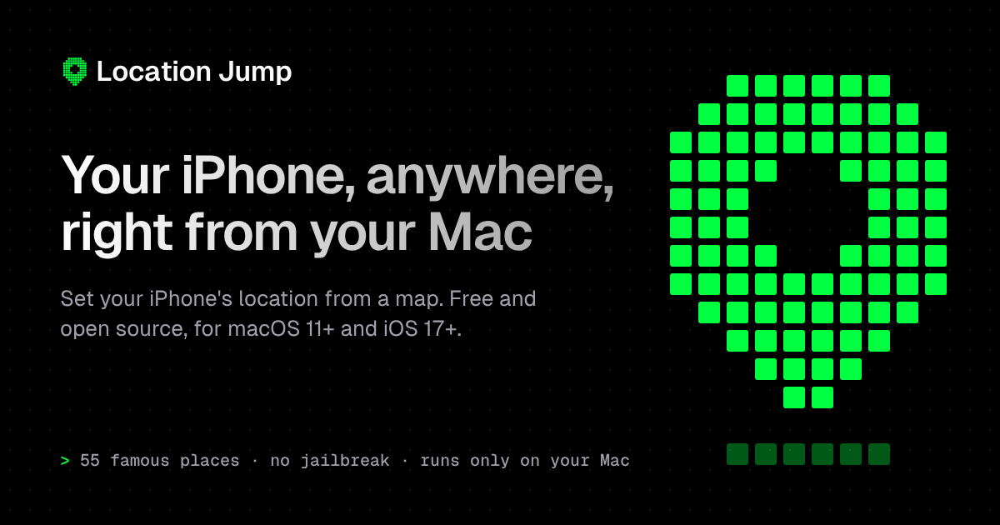
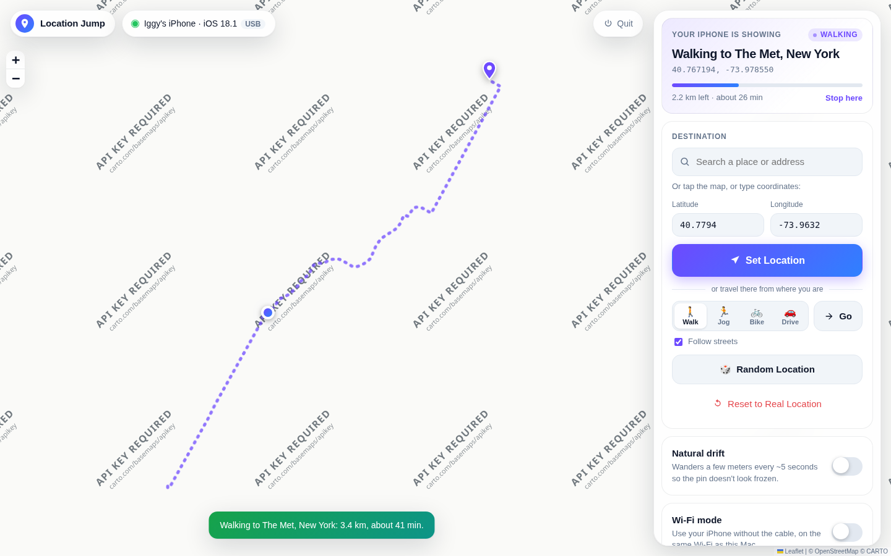
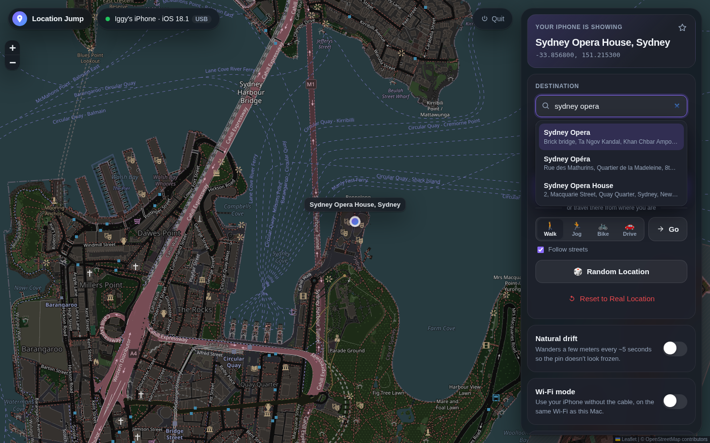

<p align="center">
  <a href="https://iggyduenas.github.io/location-jump/"></a>
</p>

<h1 align="center">
  <br>
  Location Jump
</h1>

<p align="center">
  <a href="https://github.com/iggyduenas/location-jump/actions/workflows/ci.yml"></a>
  
  
  
  <a href="LICENSE"></a>
</p>

<p align="center"><b>Website: <a href="https://iggyduenas.github.io/location-jump/">iggyduenas.github.io/location-jump</a></b></p>

A small tool for Apple silicon Macs that sets the GPS location of your USB-connected iPhone (iOS 17 or later) from a web page on your Mac. Pick a spot on a map, or hit **Random Location** to jump to one of 55 famous places. Your phone then reports that location to every app, including Snap Map.


<table>
  <tr>
    <td width="50%"><br><sub><b>Walk mode</b>: travel there along real streets</sub></td>
    <td width="50%"><br><sub><b>Dark mode</b> and place search</sub></td>
  </tr>
</table>

> **For personal fun and testing only.** While it's on, your *whole phone* thinks it's somewhere else: Snapchat, Find My, Maps, weather, and so on. Snapchat's terms don't allow location spoofing, and accounts *can* be flagged for it, so keep it to harmless jokes with people who are in on it. Press **Reset to Real Location** when you're done.

---

## What you need

- A Mac with **Apple silicon** (M1 or later, or MacBook Neo) on macOS 11 or later, and a USB cable for your iPhone. Intel Macs aren't supported.
- An iPhone running **iOS 17 or later**
- About 10 minutes for the first setup

---

## Step 1: Prepare your iPhone (one time)

1. **Set a passcode** if you don't have one. Developer Mode requires it.
2. **Turn on Developer Mode:** *Settings → Privacy & Security → Developer Mode* (at the very bottom) → turn it **on** → tap **Restart**. After the restart, unlock the phone and tap **Turn On** when asked.
   - *Don't see "Developer Mode"?* It only appears after the phone has been connected to developer tools once. Do Step 2, plug the phone in, run
     `.venv/bin/python -m pymobiledevice3 amfi reveal-developer-mode`
     in the project folder, and the option will appear.
3. **Plug the iPhone into your Mac** with the cable and **unlock it**.
4. When the phone asks **"Trust This Computer?"**, tap **Trust** and enter your passcode.
5. For Snap Map: in *Settings → Snapchat → Location*, choose **While Using the App** and turn **Precise Location** on. In Snapchat, make sure **Ghost Mode is off** (Snap Map → ⚙️), otherwise nobody sees your location anyway.

## Step 2: Get the tool onto your Mac (one time)

Open the **Terminal** app (press ⌘+Space, type *Terminal*, press Enter) and run:

```bash
xcode-select --install          # installs Python 3 and git; if it says "already installed", that's fine
python3 --version               # should print Python 3.9 or newer
git clone https://github.com/iggyduenas/location-jump.git
cd location-jump
```

If `python3 --version` doesn't print 3.9 or newer, install Python from [python.org](https://www.python.org/downloads/macos/) (the macOS installer) and open a new Terminal window.

## Step 3: Start it (every time)

In Terminal, inside the `location-jump` folder:

```bash
./start.sh
```

The script does everything for you, explaining each step as it goes. It **never asks for your Mac password**, so it works on accounts that aren't administrators too:

1. **Creates a Python "virtual environment"** in a hidden `.venv` folder and installs `pymobiledevice3` (the library that talks to iPhones) and `Flask` (the tiny web server). This happens only the first time and takes a minute or two.
2. **Opens the web page** at **http://localhost:5000** in your browser.

Since iOS 17, Apple only lets developer tools talk to an iPhone through an encrypted tunnel. Location Jump builds that tunnel itself, inside the app, as soon as you press Set Location. No administrator rights, no background service.

> **Port 5000 note:** On newer Macs, the AirPlay Receiver already uses port 5000. If so, `start.sh` tells you and uses **http://localhost:5001** instead. To get 5000 back, turn off *System Settings → General → AirDrop & Handoff → AirPlay Receiver*.

## Optional: start it without Terminal (Location Jump.app)

Run this once, in Terminal, inside the `location-jump` folder:

```bash
./install-app.sh
```

It creates **Location Jump** in your Applications folder (the one in your home folder), with its own icon. From then on:

- Open it from **Launchpad** or **Spotlight** (⌘+Space, type *Location Jump*), or drag it into the **Dock** for one click.
- The first time, it sets itself up for a minute or two (you'll see a notification).
- The app keeps running in the background (there's no Dock icon or Terminal window) and opens the page in your browser. Opening it again while it's running just brings the page back.
- To stop it, press **Quit** at the top right of the page. That puts your iPhone back to its real location first.

Good to know:
- The app runs the code from your `location-jump` folder, so **keep that folder where it is**. If you move or rename it, run `./install-app.sh` again from the new place.
- If you keep the folder in Documents or Desktop, macOS may ask once whether Location Jump may access that folder. Click **Allow**.
- Its log is at `~/Library/Logs/LocationJump.log` (open it with the Console app) if something goes wrong.
- To remove the app: `./install-app.sh --uninstall`.

## Step 4: Use it

- The **status light** in the top-right should turn **green** ("Connected to *your iPhone*. Ready."). If it's yellow or red, it tells you in plain English what to fix (see Troubleshooting below).
- **Search for a place**: type a landmark, city, or street address in the search box (for example *Eiffel Tower* or *1600 Amphitheatre Parkway*), pick a result with the mouse or the arrow keys + Enter, then press **Set Location**. Search uses OpenStreetMap, so your Mac needs internet for it.
- Or **click anywhere on the map** (or type a latitude and longitude), then press **Set Location**.
  - The **very first time**, this takes up to a minute: the tool downloads Apple's "Developer Disk Image" and installs it on your phone. After that it's instant.
- **🎲 Random Location** jumps to a random famous place (Eiffel Tower, Shibuya Crossing, Sydney Opera House, the Pyramids, and 51 more).
- **Natural drift** wiggles your position by a few meters every ~5 seconds, so on Snap Map you look like a real person standing around rather than a frozen pin. It never wanders more than about 8 meters from the spot you chose. Turning it off snaps you back to the exact spot.
- **Travel there (walk mode)**: instead of teleporting, pick a destination (search, map, or coordinates), choose **🚶 Walk**, **🏃 Jog**, **🚲 Bike** or **🚗 Drive**, and press **Go**. Your phone moves there at that speed (about 5, 10, 18 or 48 km/h), following real streets. A dashed line shows the route, and the top card shows a progress bar, the distance left, and the time remaining. Press **Stop here** to stay wherever you've got to. Turn off **Follow streets** to go in a straight line. Routes come from the free OpenStreetMap routing service; if it can't find one (for example across an ocean), the trip goes in a straight line and the app tells you. If the phone disconnects mid-trip, the trip pauses and carries on after reconnecting.
- **Wi-Fi mode** (use it without the cable): with the iPhone **plugged in**, turn on **Wi-Fi mode** in the panel (it's the same as Finder's "Show this iPhone when on Wi-Fi"). After that you can unplug: the tunnel finds the phone over your Wi-Fi within about a minute, and the status pill shows **Wi-Fi** instead of **USB**. If you were already faking a location when you unplugged, auto-reconnect picks the phone back up over Wi-Fi and restores it. Things to know:
  - The phone and Mac must be on the **same Wi-Fi network**. Office, hotel and guest networks often block devices from seeing each other, and then only the cable works.
  - Keep the phone **awake** (unlocked, or charging) for the first connection. iPhones turn Wi-Fi down when they sleep, so the connection can drop and come back. Auto-reconnect handles that, but the cable is more reliable.
  - The switch can only be changed while plugged in (Apple's rule). Turn it off the same way.
- **Several devices** (say your iPhone and an iPad, or a friend's phone): when more than one is connected, Location Jump **won't guess**. It asks which one to use, right in the panel. Later you can switch by clicking the status at the top. Switching puts the previous device back to its real location first. If the device you chose is unplugged, the app waits for *that* device rather than quietly switching to another. The first device you fake a location on is remembered, so plugging in a second one later changes nothing.
- **Favorites and Recent** (bottom of the panel): tap the **☆** next to the place your phone is showing to save it as a favorite. Every place you jump to is added to **Recent** automatically (the last 12). Click any saved place to jump straight there. They're stored in `saved_places.json` in the project folder, so they survive restarts.
- **Your iPhone is showing** shows the exact coordinates your phone is reporting right now. The red dot on the map is the same thing.
- **Reset to Real Location** puts your phone back to its real GPS.

**Check it worked:** open Apple Maps or Snapchat → Snap Map on the phone. Snap Map updates your Bitmoji when you open the app, so open (or re-open) Snapchat after changing location.

**Keep the phone plugged in and the app running** while you want the fake location. The fake location stays only while this tool is connected. If you press **Ctrl+C** in Terminal, the tool resets your phone to its real location before quitting.

**Auto-reconnect:** if the cable comes loose, the phone restarts, or the tunnel hiccups, your phone goes back to its real location for a moment. The status turns orange ("Reconnecting to iPhone…") and the app keeps retrying every few seconds. As soon as the phone is reachable again (plugged in and unlocked), your fake location is put back automatically. Press **Reset to Real Location** if you'd rather it didn't come back.

## Step 5: When you're done

1. Press **Quit** at the top right of the page (or **Reset to Real Location**, or Ctrl+C in Terminal).
2. That's it: nothing keeps running in the background once the app has quit.

---

## Troubleshooting

| What the status says | What to do |
|---|---|
| **No iPhone found** | Plug the phone in with a cable that carries data (some cheap cables only charge), unlock it, and wait a few seconds. |
| **Your iPhone is asking "Trust This Computer?"** | Unlock the phone, tap **Trust**, and enter your passcode. |
| **Your iPhone doesn't trust this Mac yet** / **You tapped "Don't Trust"** | Unplug and replug the cable, then tap **Trust**. If the prompt never appears: *Settings → General → Transfer or Reset iPhone → Reset → Reset Location & Privacy*, then replug. |
| **Unlock your iPhone** | Unlock it with your passcode and try again. |
| **Developer Mode is off** | See Step 1.2 above. The phone has to restart after turning it on. |
| **Couldn't open the secure connection to your iPhone** | Keep the phone plugged in and unlocked, and press the button again. If it keeps happening, update the iPhone to iOS 17.4 or later. |
| **Couldn't download the Developer Disk Image** | The first Set Location needs internet on the Mac. Check your connection and try again. |
| **Lost the connection to the iPhone** | Usually the cable wiggled or the phone locked during setup. Just press the button again; the tool reconnects automatically. |
| **Reconnecting to iPhone…** stays on | Plug the phone back in and unlock it. If it still doesn't recover after ~30 seconds, quit Location Jump and open it again, and your fake location comes back once the app reconnects. |
| Wi-Fi mode is on but the status says **No iPhone found** after unplugging | Wait up to a minute with the phone unlocked. Check both are on the same Wi-Fi network (not a guest network). Still nothing? Plug the cable back in; it always works. |
| **Couldn't reach the place search** | Search needs internet on your Mac. You can still click the map or use Random. |
| Browser shows **"403 Forbidden"** at localhost:5000 | That's the Mac's AirPlay Receiver, not this app. Use the address `start.sh` printed (probably http://localhost:5001). |
| App says **Python 3 isn't installed** | Run `xcode-select --install`, then `python3 --version`. If that doesn't print 3.9 or newer, install Python from [python.org](https://www.python.org/downloads/macos/). The real reason is in `~/Library/Logs/LocationJump.log`. |
| Phone seems stuck on a fake location | Press **Reset to Real Location**. If the tool isn't running anymore, simply **restart the iPhone**; that always restores the real GPS. |

While debugging, run `./start.sh` in Terminal (not the app) to see the app's log as it happens.

---

## How it works (for the curious)

```
Browser (map UI) ──HTTP──► Flask app (app.py) ──► phone.py ══encrypted iOS 17 tunnel (in-process, no root)══► iPhone
```

- **`start.sh`**: setup and launch.
- **`app.py`**: the Flask app, served by waitress, and its small JSON API (`/api/status`, `/api/location`, `/api/random`, `/api/reset`, `/api/drift`, `/api/walk`, `/api/state`, `/api/search`, `/api/saved`, `/api/favorites`, `/api/recents`, `/api/device`, `/api/wifi`, `/api/ping`, `/api/quit`).
- **`phone.py`**: all the iPhone logic. It checks USB, trust, and Developer Mode in that order, so the status tells you the *first* thing that's wrong. It opens the iOS 17 tunnel itself without root (pymobiledevice3's userspace tunnel on iOS 17.4+, or the tunnel macOS already keeps for the phone on iOS 17.0–17.3), and keeps one long-lived developer connection open through it, because iOS drops the simulated location when that connection closes. A background loop re-sends the location every few seconds (moving it slightly when drift is on), which is also how it notices a dropped connection and restores the location after reconnecting.
- **`places.py`**: the 55 famous places for Random Location.
- **`search.py`**: place search through OpenStreetMap's Nominatim service (rate-limited to 1 request per second and cached, per their usage policy).
- **`routing.py`**: walk mode: street routes from routing.openstreetmap.de and the "where are we after N meters" math.
- **`storage.py`**: favorites and recents, saved to `saved_places.json`.
- **`templates/` + `static/`**: the web page. The map library (Leaflet) is bundled in `static/vendor/`, so the app works offline; only the map tiles, search and street routes need internet.
- **`tests/`**: automated tests that use a pretend iPhone.

- **`install-app.sh`** + **`assets/AppIcon.png`**: build the Location Jump.app launcher (which runs `start.sh --background`).

The web app only listens on `127.0.0.1`, so nobody else on your Wi-Fi can open it. It also refuses requests that other websites might try to send to it from your browser: every change must come from its own page as JSON, and requests addressed to any host other than `localhost` are rejected. The one exception is the project website (`https://iggyduenas.github.io`): its friends area may check that the app is running and set a location (`/api/ping` and `/api/location` only), after your browser asks you to allow it.

## For developers

```bash
.venv/bin/pip install -r requirements-dev.txt
make check     # lint (ruff, shellcheck, JS syntax) + all tests
make test      # just the tests
```

- **CI** (`.github/workflows/ci.yml`) runs on every push to `main` and every pull request: linting, the tests on Python 3.9 (what macOS ships), 3.11 and 3.13, and on a real macOS machine it builds the app bundle and smoke-tests `start.sh`.
- **Stress test**: `python scripts/stress_test.py` runs the real server with 40 clients against a deliberately unreliable pretend iPhone (slow, dropping, hanging, unplugging) and checks it stays responsive and correct. Options: `--clients`, `--seconds`.
- **Website**: the project site lives in `site/`. `python scripts/build_site.py` assembles it into `_site/`, and the *Website* workflow publishes it to GitHub Pages on every push to `main` that changes it.
- **Screenshots**: run the *Screenshots* workflow from the Actions tab (or `python scripts/screenshots.py` locally) to regenerate the images in `docs/screenshots/` with a pretend iPhone.
- **Version** lives in `version.py`; changes are listed in [CHANGELOG.md](CHANGELOG.md).

## License

[MIT](LICENSE). The bundled Leaflet library is BSD-2-Clause (`static/vendor/leaflet/LICENSE`). Map data and tiles © OpenStreetMap contributors.
